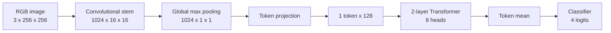
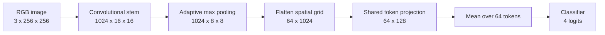
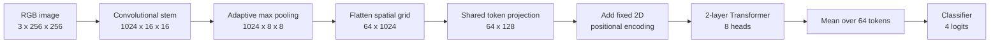

# Proposed custom architectures

This document describes the three custom-family variants implemented for the
Phase 3D development pilot. They share a convolutional feature extractor and a
four-class prediction head, but differ in how the feature map is represented
before classification.

Variant A reconstructs the topology found in the historical project. Variants B
and C are controlled proposals used to test whether retaining spatial tokens—and
then applying self-attention to them—changes the model's behaviour. These are
development candidates, not final publication models.

The implementation is in `phase3d/models_v1.py`. Immutable pilot configurations
are under `configs/phase3d_v4/`.

## Shared convolutional stem

For deterministic CUDA training at the fixed 256-pixel input, the implementation
uses ordinary 2x2 max pooling for the exact 16x16 to 8x8 reduction and `amax` for
the global 1x1 reduction. Their forward values are identical to the corresponding
adaptive max pools on these fixed shapes; this avoids PyTorch's nondeterministic
`adaptive_max_pool2d` CUDA backward.

All variants accept a normalized RGB tensor with shape `[B, 3, 256, 256]` and
apply four blocks of:

```text
3x3 convolution -> batch normalization -> PReLU -> 2x2 max pooling
```

The spatial and channel dimensions evolve as follows:

| Stage | Output shape, excluding batch |
|---|---:|
| Input | `3 x 256 x 256` |
| Block 1 | `128 x 128 x 128` |
| Block 2 | `256 x 64 x 64` |
| Block 3 | `512 x 32 x 32` |
| Block 4 | `1024 x 16 x 16` |

The shared token projection is applied independently to feature vectors:

```text
1024 -> 512 -> 256 -> 128
```

It uses dropout 0.3 after the 512- and 256-dimensional layers, ReLU for those
layers, and GELU for the final 128-dimensional embedding. The shared classifier
is:

```text
128 -> 64 -> 32 -> 4 classes
```

## Variant A — historical singleton token



The Transformer receives `[B, 1, 128]`. With only one token, its attention
softmax has no alternative spatial locations to compare. The encoder can still
transform the representation through projections, residual paths and its
feed-forward network, but it does **not** perform attention between image
regions. Accordingly, this variant is labelled `historical_singleton` and must
not be described as spatial self-attention.

- Transformer: two layers, eight heads, feed-forward width 512.
- Positional encoding: none.
- Total/trainable parameters: **7,298,408**.
- Role: historical-form reference using the corrected shared trainer.

## Variant B — spatial stem without attention



This variant preserves an 8x8 feature grid and creates 64 spatial tokens, but
does not use a Transformer. It is the controlled stem-only ablation for Variant
C.

- Transformer: none.
- Positional encoding: none.
- Total/trainable parameters: **6,901,864**.
- Role: determine what the convolutional stem and spatial representation achieve
  without self-attention.

## Variant C — corrected spatial-token Transformer



The Transformer receives exactly `[B, 64, 128]`, so each of the 64 spatial
regions can attend to every other region. Runtime checks reject a singleton or
otherwise malformed sequence.

- Transformer: two layers, eight heads, feed-forward width 512.
- Positional encoding: fixed separable 2D sinusoidal encoding.
- Total/trainable parameters: **7,298,408**.
- Role: corrected spatial-attention candidate pending broader evidence.

For grid coordinates `(x, y)`, the positional representation uses sine and
cosine components for the horizontal and vertical coordinates separately. It
contains no radial prior and introduces no learned positional parameters.

## What the comparisons isolate

| Comparison | What changes | Valid interpretation |
|---|---|---|
| B vs. C | Transformer plus its fixed positional encoding | Controlled test of the spatial-attention pathway on the same stem, token projection and classifier |
| A vs. C | Singleton/global representation becomes a 64-token spatial representation | Comparison of historical-form and corrected topology; not a pure attention ablation |
| A vs. B | Global singleton representation becomes spatial tokens and the Transformer is removed | Diagnostic comparison; several architectural factors change |

The Phase 3D pilot demonstrated that all three implementations can learn on a
small development subset. Its scores must not be used to rank the architectures:
the pilot used one seed, 48 training images and 24 validation images, and the
split is not yet certified as independent by astronomical object.

## Architectural invariants

The implementation and tests enforce the following contracts:

- A receives exactly one 128-dimensional token and declares no spatial-attention
  claim.
- B and C receive exactly 64 tokens of dimension 128.
- B and C share the same stem, token projection and classifier definitions.
- C rejects any sequence other than `[B, 64, 128]`.
- C uses a fixed Cartesian 2D encoding; radial positional priors are rejected.

See `tests/test_phase3d.py` for executable checks and
`reports/phase3d_20261016/REPORT.md` for the bounded pilot protocol and results.
